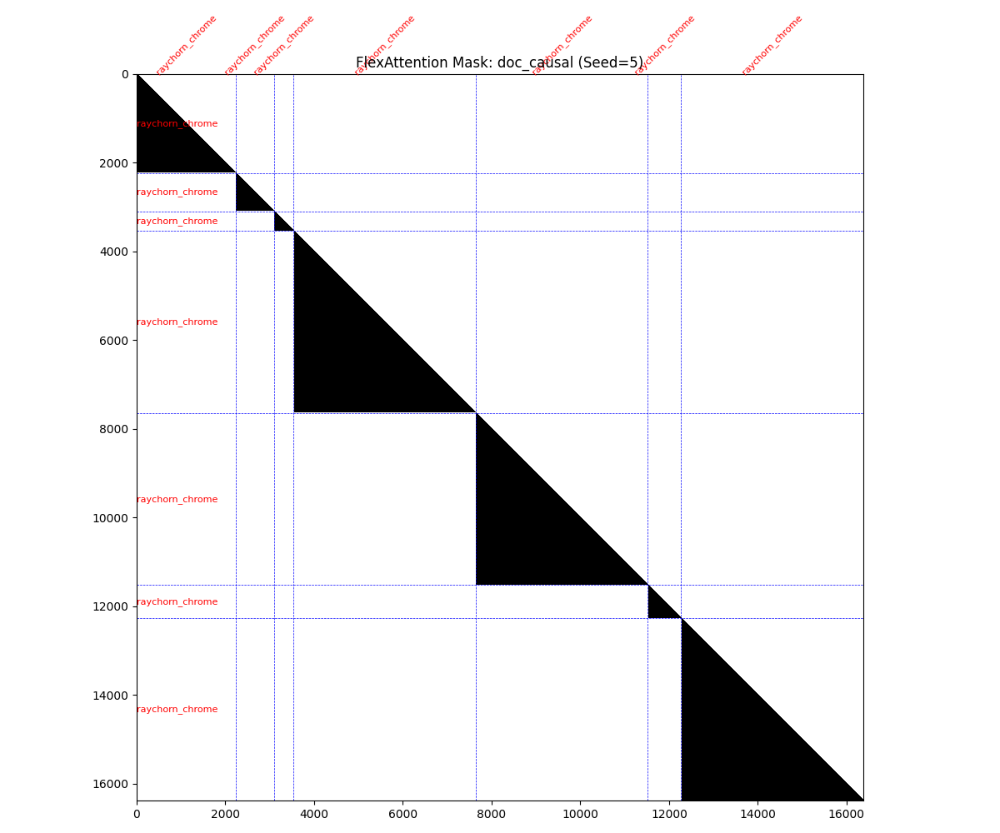
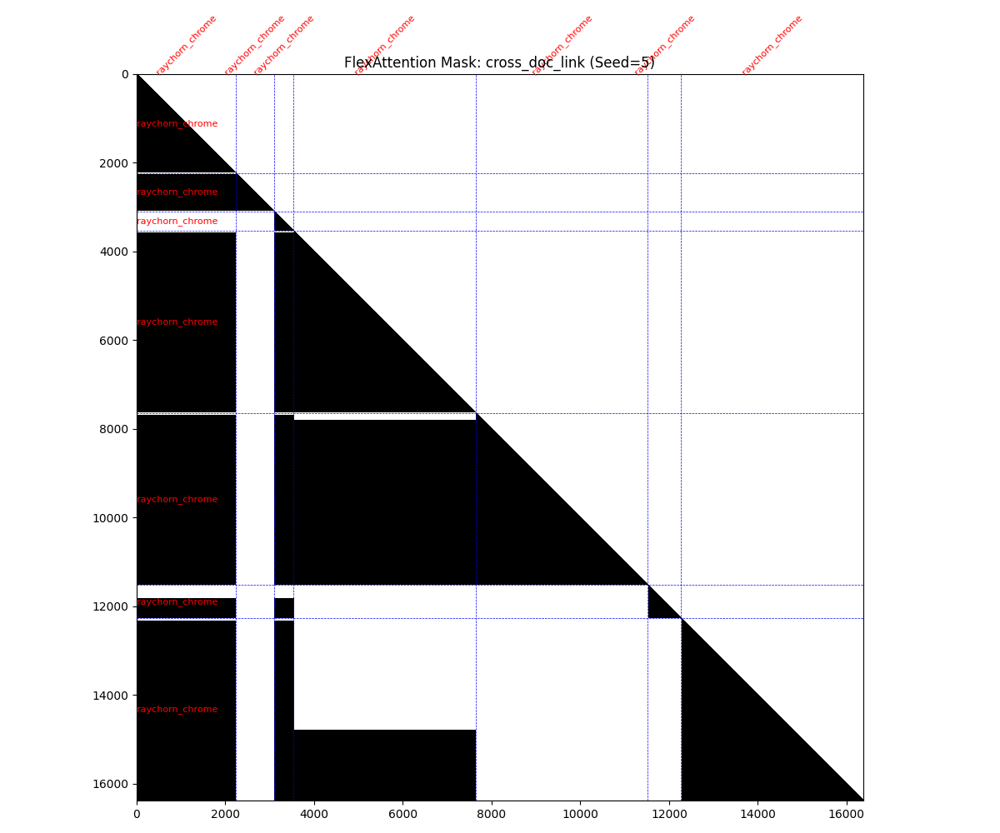
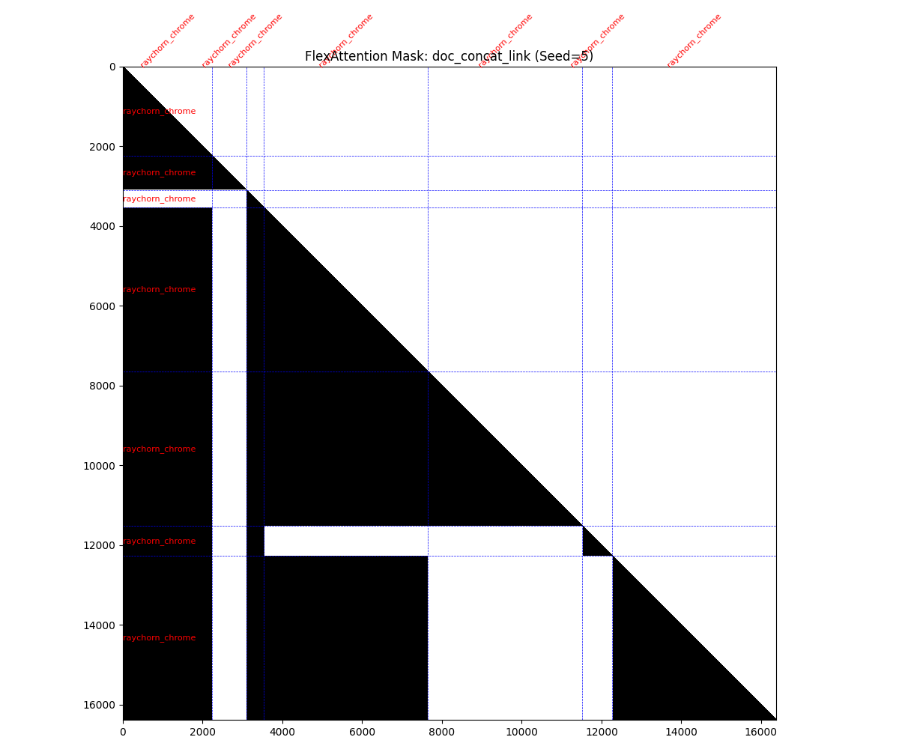
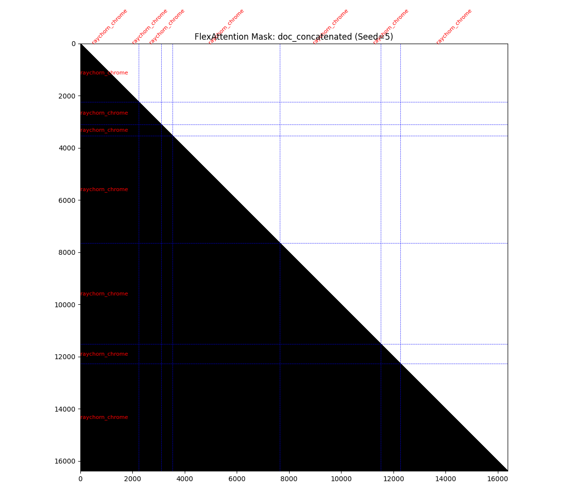
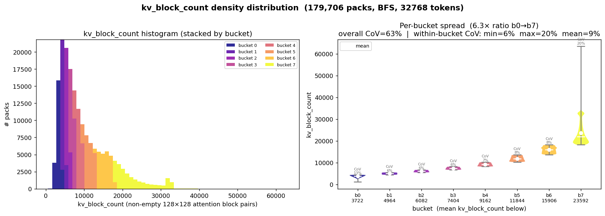
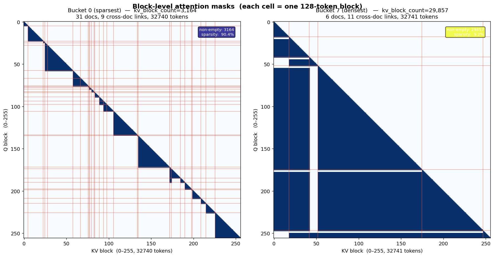
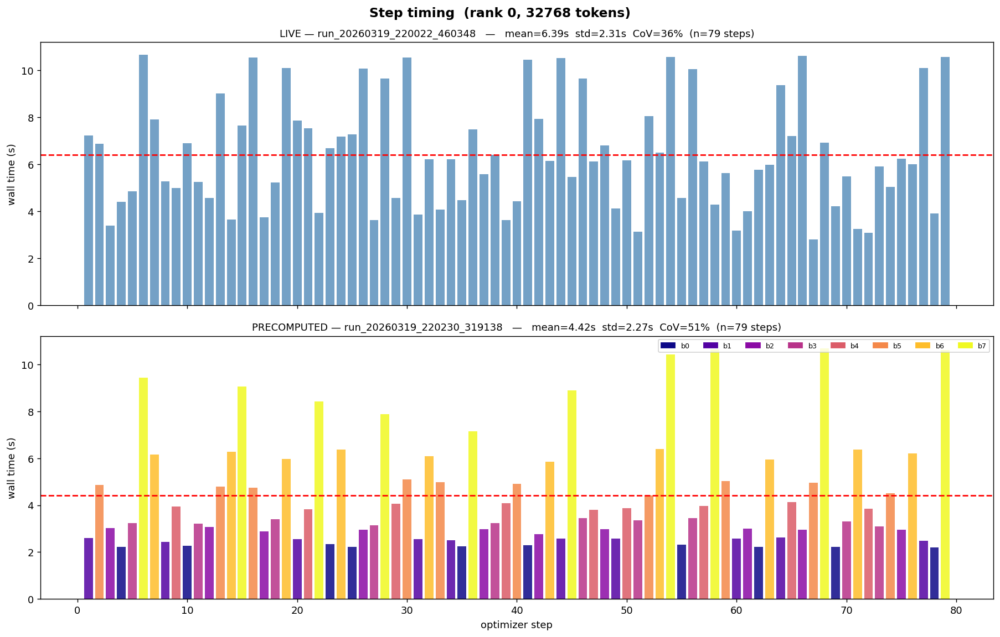
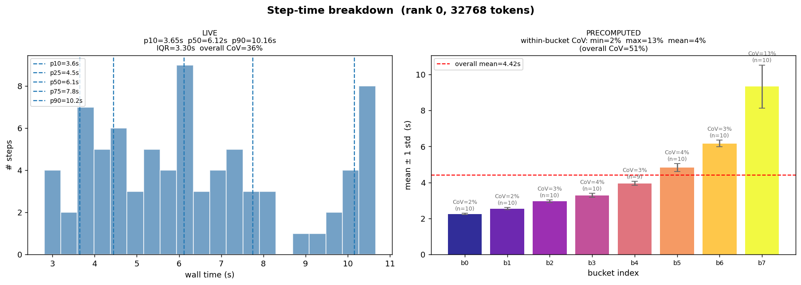

# Text Attributed Graph Sequence to Text Attributed Graph Sequence (TAGSeq2TAGSeq)

A framework for training language models on **graph-structured text** — where documents are nodes and hyperlinks or import dependencies are edges. Rather than treating corpora as flat token streams, this project makes the link structure a first-class part of both training and inference.

See [Pipeline](#pipeline) below for how to build data, train, generate and evaluate.

---

## The Core Idea

Most text corpora have implicit graph structure that standard language model training ignores. A Wikipedia article on *Fluid dynamics* links to *Hydraulics*, *Archimedes' screw*, and *Lever*. A Python file `mcts.py` imports `chess/board.py`, `chess/move.py`, and `model/tensorflow/model.py`. These links are not noise — they signal that the linked content is semantically relevant to the current document.

TAGSeq2TAGSeq exploits this structure in two ways:

1. **Graph traversal packs related documents together.** Instead of sampling random token windows, a graph traversal (BFS or DFS) walks the link graph and fills each training sequence with documents that are topologically close to one another.

2. **A custom attention mask decides what each token can see.** At minimum, documents are causally isolated from one another — tokens in one article cannot attend to tokens in an unrelated article packed into the same sequence. Optionally, when document A explicitly links to document B and both are in the batch, tokens in A can attend back across the document boundary into B.

---

## Attention Masks

The attention pattern is the heart of the method. The four conditions below are
**all shown on the same 16k-token batch** (one repository from The Stack), ordered
by the amount of attention they permit (and thus FLOPs per token):
`doc_causal` < `cross_doc_link` ≤ `doc_concat_link` ≤ `doc_concatenated`. The two
`doc_concat_*` masks exist as **compute controls**: they grant *more* attention
than `cross_doc_link` but with no inference-time linking, so a `cross_doc_link`
win can be attributed to the linking inductive bias rather than to extra compute.

### `doc_causal` — document-isolated causal attention

Each document attends only to itself. The mask is a block-diagonal of lower triangles: no information crosses document boundaries. This is the baseline — equivalent to training on independently sampled documents, but with the efficiency benefit of packing many short documents into one long sequence.



*Each diagonal block is one Python file. Blue dashed lines mark document boundaries. Documents are completely isolated from one another.*

---

### `cross_doc_link` — link-aware cross-document attention

When document A contains a link to document B (and B is present in the batch), tokens in A *from the link position onward* are granted read-access to all tokens in B. The causal structure within each document is preserved; the cross-document grants are asymmetric (A can read B, but B cannot read A unless it also links back).



*Python files from one repository. Where a file imports an earlier file in the batch, its rows extend leftward as a black block — but only from the import line down, so each grant block's top edge sits below the source file's start.*

This teaches the model a grounded form of cross-document reasoning: when you encounter an import or a hyperlink, the full content of the referenced document is available in your attention context.

---

### `doc_concat_link` — whole-document link concatenation (compute control)

Identical to `cross_doc_link` except a detected link grants attention from the *entire* source document, not just from the link position onward. Equivalent to concatenating the source document onto its target. This strictly enlarges every `cross_doc_link` grant, so it isolates the effect of the precise link-position gating: same connectivity, more attention, no inference-time link prediction.



*Same batch as `cross_doc_link` above. Each grant block now extends up to the top of its source file — compare the tall bottom-left block here against the shorter one in the previous figure, which started at the import line.*

---

### `doc_concatenated` — connected-component concatenation (compute control)

Documents that form a connected component in the link graph (e.g. files within a repository that import one another) are merged into a single causally-concatenated super-document: full causal attention across their combined tokens. Components that share no links remain isolated, so the mask is a block-diagonal of *larger* triangles — one per component, not one per document.



*All files in this batch are import-connected, so they merge into a single super-document triangle — the per-file boundaries (blue dashed lines) are ignored entirely. Had the batch contained an unrelated, unlinked file, it would sit in its own separate triangle.*

This grants the most attention of the four conditions, with no inference-time linking — the upper compute control.

---

## Graph Traversal

How documents are ordered within a sequence matters for `cross_doc_link`: a document can only attend to documents that appear *before* it in the sequence. The traversal strategy controls this ordering.

- **BFS** (breadth-first): explores the neighbourhood of a seed document level by level. Documents close in graph distance are packed together and predecessors tend to appear before successors. This is the preferred strategy for `cross_doc_link` training.
- **DFS** (depth-first): follows one path deep into the graph before backtracking. Produces longer chains of topically related documents.
- **Random walk**: a Markov walk with restart probability, producing soft locality without strict BFS ordering.
- **Random**: uniform random selection — equivalent to standard document sampling, used as a control baseline.

Within each strategy, a token budget and per-document token cap control sequence length and ensure no single document dominates the pack.

---

## Datasets

All pretokenized datasets live under `/fss-data/evin_t/tagseq2tagseq_artifacts/pretokenized_datasets/`,
each with `splits/{train,val_community,val_random,test_community,test_random}`. Precomputed
schedules live under `.../schedules/<dataset>_<strategy>/epoch_N`.

| Dataset | Edge type | Link detector |
|---------|-----------|---------------|
| `wiki_merged` (8 Wikimedia projects, incl. `simplewiki`, `enwikisource`) | Markdown hyperlinks | `markdown` |
| `thestack` (Python from The Stack) | `import` statements | `python` |
| `go`, `java`, `typescript`, `javascript`, `kotlin`, `rust`, `zig`, `dart` | imports / module references, parsed with tree-sitter | one per language |
| `arxiv` (unarXive 2024 + OpenAlex) | `\cite{}` citations | `arxiv` |
| `fineweb` | none (edgeless baseline) | `null` |
| `merged_all_v2` (11 linked sources) | all of the above | `composite` (per-document dispatch) |

### Link detectors

Each modality is served by a pluggable `LinkDetector` (`model/graph_traversal/*_detector.py`,
registry in `link_detector.py`) that runs online: during training to find the token positions
where links close, and during generation to detect links in newly generated text. The
`composite` detector dispatches per document, so a model trained on mixed sources can generate
across modalities. `data/graph_harness/` is a model-free conformance suite for the code
detectors (detection and resolution against tree-sitter fixtures).

---

## Density-Aware Batch Scheduling

Cross-document attention masks are inherently **sparse** — how sparse depends on how many inter-file import links are active in a given pack. In a 32k-token sequence with 6 large files that heavily import each other, most attention blocks are live. In a pack with 31 small isolated files, almost all blocks are empty. This 6× variation in FlexAttention backward cost is the main source of DDP rank imbalance: the fast rank finishes its backward and then idles at the NCCL allreduce waiting for the slow rank to catch up.

### The problem in numbers

The `kv_block_count` metric counts non-empty 128-token block pairs in the full attention mask. Across 180k packs from The Stack (32k context, BFS, 8 buckets):



*Left: kv_block_count is right-skewed — most packs are sparse, but the dense tail drives worst-case step times. Right: each bucket has tight within-bucket variance; the ratio between sparsest (b0) and densest (b7) buckets is 6.3×.*

The mask for a representative pack from each extreme bucket makes the difference visceral:



*Each cell is one 128-token block; blue = non-empty. Bucket 0 (31 short docs, 9 links): isolated diagonal triangles, 90% sparse. Bucket 7 (6 large docs, 11 links): large filled rectangles from cross-doc grants, only 9% sparse. Red lines mark document boundaries.*

### The solution

**Offline epoch pre-computation** with **density-bucketed training**:

1. Before training, run `precompute_epochs.py` once per epoch. It generates all packs for the epoch using the same BFS traversal and link detection as live training, then computes `kv_block_count` analytically (~1 ms/pack, CPU only, parallelised across workers). Packs are sorted into equal-count quantile buckets.

2. During training, `BucketedPackDataset` draws each accum step's `world_size` packs from the **same** density bucket, guaranteeing all ranks see the same backward cost. The bucket sequence shuffles across buckets so each optimizer step spans a different density level, maintaining gradient diversity.

This eliminates within-step rank imbalance entirely. Different optimizer steps vary in speed (the scheduler visits all buckets), but all ranks are always equally loaded.

### Measured impact (2 nodes × 2 GPUs, The Stack 10M, 32k tokens)



*Top: live training — unpredictable step times (2–11s) with no structure. Bottom: precomputed training — steps colour-coded by density bucket; dark blue (sparse) is fast, yellow (dense) is slow, but the pattern is fully deterministic.*

The per-bucket breakdown makes the contrast concrete:



*Left: live training has a broad, near-uniform step-time distribution (IQR=3.3s, CoV=36%) — no bucket structure because packs are assigned randomly. Right: precomputed training has tiny within-bucket variance (CoV 2–13%, mean 4%) because both ranks always draw from the same bucket; the overall CoV (51%) is entirely between buckets — predictable and density-driven.*

| | Mean step time | Max step time |
|---|---|---|
| Live (online link detection, random density) | 6.39 s | 10.7 s |
| Precomputed (density-bucketed, no link detection) | 4.42 s | 9.4 s |
| **Speedup** | **1.45×** | **1.14×** |

The 1.45× mean speedup comes from two combined effects:
- **Eliminating online link detection** (`PythonImportDetector` at 32k tokens adds ~1.3 s/step on average; precomputed packs store link positions offline).
- **Rank-stall reduction** from density matching (most visible on multi-node InfiniBand; effectively zero on single-node NVLink).

See [Precompute epochs](#3-precompute-epochs) for usage.

---

## Model Architecture

A decoder-only transformer with rotary position embeddings and QK-norm, trained in bfloat16 with
Muon (2D weight matrices) plus AdamW (embeddings, norms, scalars). The embedding and unembedding
are tied for the first two thirds of training and then untied.

The only architectural novelty is the attention mask. Training uses custom block-sparse Triton
flash-attention kernels (`kernels/`): `cross_doc_bitmask_bim_v18` for the link masks and
`varlen_bim_v2` for the doc-causal masks. Both precompute a per-batch block interaction table
(BIM) so empty blocks are never launched, and they measured faster than FlexAttention at 32k
context with the same memory (`kernels/KERNELS.md`). FlexAttention remains available
(`model.attention_backend: flex`) and is what inference uses.

Configurations range from 12L/768D (2k context) to 36L/1280D (32k context). Multi-node training
uses DDP launched through SLURM/submitit.

---

## Generation

At inference time, `generate.py` loads a checkpoint and generates text autoregressively. When `--max-link-depth` is greater than zero, the model runs a link-detection pass after each token is generated. Links that resolve to documents in the corpus are fetched and prepended to the attention context before generation continues — a retrieval mechanism that mirrors exactly what the model was trained to expect.

For links that do not resolve to corpus documents, `--allow-generation-fallback` triggers generation of the auxiliary document from scratch, enabling open-ended multi-document synthesis.

The generation loop currently recomputes the full forward pass at every token; there is no key/value cache yet.

---

## Pipeline

Paths below abbreviate `/fss-data/evin_t/tagseq2tagseq_artifacts` as `$ART`. Bulk data never goes
on `/fss`; see [Where data lives](#where-data-lives).

### 0. Environment

```bash
uv venv --python /nfs/cluster/miniconda3/bin/python3.13 .venv
VIRTUAL_ENV=$PWD/.venv uv pip install -r <requirements>     # torch 2.10, triton 3.6, tree-sitter-*, ...
VIRTUAL_ENV=$PWD/.venv uv pip install -e /fss/evin_t/tunalab \
    -e /fss/evin_t/tunalab/catalogs/common -e /fss/evin_t/tunalab/catalogs/nlp -e '.[dev]'
python -m pytest tests/ -q
```

The last full package set is recorded in `$ART/worktree_archive/venv_freeze_2026-10-28.txt`
(drop its `nvidia-*`/`cuda-*` pins and let torch choose them).

### 1. Build a dataset

Every dataset ends as a pretokenized directory: binary token shards, `tokenized_graph.jsonl`
(nodes + edges) and `metadata.json`.

- **Wikimedia**: `scripts/wiki_dump_pipeline.sh <tag> <dump.json.gz> <procs>` runs
  extract → `data.wiki_graph_extractor.build_graph` → `data.pretokenize` for one dump;
  `scripts/wiki_merge_finalize.sh` merges the per-dump datasets into `wiki_merged`
  (`data/merge_datasets.py`).
- **Code languages** (one language at a time, see CLAUDE.md on staggering):
  ```bash
  LANG=rust NPARQ=21 sbatch --array=0-20%12 scripts/download_stack_lang.sbatch   # the-stack-dedup shards
  LANG=rust sbatch scripts/build_graph_lang.sbatch                               # tree-sitter import graph
  LANG=rust sbatch scripts/finish_dataset_lang.sbatch                            # pretokenize, split, audit
  bash scripts/make_review_artifacts.sh rust rust                                # human-readable review bundle
  ```
  Python (`thestack`) uses `data/github_graph_extractor/` and `data.pretokenize_stack`.
- **arXiv**: `data/arxiv_graph_extractor/` (`build_openalex_map` → `extract` →
  `data.pretokenize_arxiv`); each step is arg-driven and CPU-heavy, so run it on a compute node.
- **Merged corpus**: `scripts/build_merged_v2_packs.sh` balances and re-buckets per-source
  schedules into one (`data/merge_packs.py`); `scripts/precompute_merged_v2_val.sh` builds its
  per-source val schedules.

### 2. Split

```bash
python -m data.split_graph --dataset-dir $ART/pretokenized_datasets/<name> [--dry-run]
```

Writes five disjoint, self-contained splits under `splits/`. Cross-split edges are dropped.

| Split | Purpose |
|-------|---------|
| `train` | training |
| `val_community` | BFS-grown subgraphs with link structure intact: periodic val loss, `community_pack_perplexity` |
| `val_random` | isolated uniformly-sampled nodes: `held_out_perplexity` |
| `test_community`, `test_random` | same shapes, held back for final evaluation |

### 3. Precompute epochs

Packs are generated offline with the same traversal and link detection as live training, scored
for attention density (`kv_block_count`, ~1 ms/pack on CPU) and sorted into quantile buckets.
Training then draws every rank's pack from the same bucket.

```bash
python precompute_epochs.py \
    --dataset-dir $ART/pretokenized_datasets/thestack/splits/train \
    --output-dir  $ART/schedules/thestack_bfs \
    --n-epochs 5 --strategy bfs --local-seq-len 32768 --n-buckets 32 --n-workers 16 --seed 42 \
    --link-detector python --layout-policy stochastic_identifier_prefix
# or, per language on SLURM:
LANG=rust DET=rust STRAT=bfs LAYOUT=stochastic_slash_comment_prefix sbatch scripts/precompute_lang.sbatch
```

`--local-seq-len` must equal `model.max_seq_len` and `--layout-policy` must match the training
layout. Precompute is resume-safe (finished epochs are skipped). Regenerate schedules after any
dataset rebuild. `--keep-frac` / `--traversal-keep-frac` subsample edges for density studies.

### 4. Train

```bash
python launch_slurm.py --nodes 1 --gpus-per-node 8 --time 48:00:00 \
    --config configs/thestack_sweep/thestack_veoff_cdl.yaml \
    [--section.key value ...] [--resume-from <run_dir>/checkpoints/latest.pt]
```

- Overrides are **dotted keys only** (`--model.mask_type`, `--data.epoch_dirs`, ...). The launcher
  defines no shorthand flags.
- `configs/` holds one tuned config per dataset and mask: `<ds>_sweep/<ds>_veoff_{dc,cdl,concat,concatlink}.yaml`,
  plus `wiki_*_best.yaml`, `merged_v2_8b_*.yaml` and `fineweb_doc_causal.yaml`. Several still set
  `train_loop.warmup_steps`, which `main.py` rejects; replace it with `train_loop.warmup_percent`.
- `data.epoch_dirs` (a list of precomputed epochs) switches training to `BucketedPackDataset`.
- Resume is exact across world sizes (Muon + AdamW state is keyed by parameter name; dataset
  position is saved with every checkpoint).
- Multi-rank runs need a pre-warmed compile cache, and jobs must be launched one at a time
  (CLAUDE.md). `scripts/stagger_launch.sh` launches a list of configs that way.
- Run directories go under `$ART/runs/` (`TS2TS_RUNS_ROOT` overrides).

### 5. Generate

```bash
python generate.py --checkpoint <run_dir>/checkpoints/latest.pt \
    --dataset $ART/pretokenized_datasets/thestack \
    --root-identifier "trainer.py" --prompt "import torch ..." \
    --max-new-tokens 500 --max-link-depth 2 --repetition-penalty 1.1
```

`generate.py` rebuilds the architecture, tokenizer, link detector and layout policy from the run's
saved hyperparameters. With `--dataset`, links detected in generated text are resolved against the
corpus and the targets inserted into the attention context; `--allow-generation-fallback`
generates targets that don't resolve; `--link-detector composite` serves merged models.
Checkpoints trained with an identifier-prefix layout need `--root-identifier`. For code use
`--repetition-penalty 1.05–1.15` (the 1.3 default suits prose).

### 6. Evaluate

```bash
python eval_checkpoints.py --checkpoints <ckpt> [<ckpt> ...] \
    --dataset $ART/pretokenized_datasets/<name> [--benchmarks ...] [--split val_community]
```

Each invocation gets its own eval run directory under `$ART/evals/` (never inside the training
run). Benchmarks include held-out and community-pack perplexity, standard single-document NLP
benchmarks (`eval/nlp_benchmarks.py`), and cross-document benchmarks scored with and without the
link (`eval/benchmark_harness/`: RepoBench, CrossCodeEval and HotpotQA-style ports;
`scripts/eval_ports_slurm.sh <label> <run_dir>` runs them on SLURM). Experiment-specific evals:
`eval/sparsity_sweep.py` (edge-density sweeps, `scripts/sparsity_phase1_sweep.sh`,
`scripts/eval_sparsity_*.sbatch`), `eval/memorization.py`, `eval/link_injection_grid.py`.
Plots for these are in `eval/viz/`.

### 7. Inspect and visualise

| Command | Shows |
|---------|-------|
| `python demo_traversal.py <dataset_dir> --strategy bfs [--layout-policy identifier-prefix]` | a packed batch: doc spans, in-batch links, decoded snippets |
| `python visualize_llm_input.py ...` | the exact text the model sees for a pack, per-doc prefix/body/suffix and cross-doc links |
| `python visualize_annotated.py --config <cfg> ...` | link annotations over a pack |
| `python -m model.graph_traversal.block_mask_creator <dataset_dir> --mask-type cross_doc_link --link-detector python` | the attention mask of a real batch as a PNG |
| `python visualize_epoch.py --epoch-dir <epoch> --dataset-dir <split> --output-dir <dir>` | density histogram, per-bucket masks, step timing (`--live-run`/`--precomputed-run`) |
| `python benchmarks/attention_harness.py {correctness,bench,all}` | kernel correctness and speed vs FlexAttention and exact references |

---

## Where data lives

Everything bulky is under `/fss-data/evin_t/tagseq2tagseq_artifacts/` (`$ART`). The checkout
keeps symlinks at a few old paths so older records still resolve; the virtual environment is the
only large thing inside the checkout.

| Path in `$ART` | Contents |
|----------------|----------|
| `pretokenized_datasets/` | all datasets and their `splits/` |
| `schedules/` | precomputed epochs (`<dataset>_<strategy>/epoch_N`) |
| `graphs/`, `raw/`, `wiki_*` | raw downloads and intermediate graphs |
| `runs/` | training runs (`runs_legacy/`: runs written inside the old checkout, symlinked as `./runs`) |
| `evals/` | standalone eval runs |
| `cache/` | benchmark dataset caches (`main_checkout_data_cache` is `./data/.cache`) |
| `compile_cache/` | shared Triton/inductor compile caches for multi-rank runs |
| `sparsity_scaling/` | edge-density experiment outputs read by `eval/viz/` |
| `fss_home_legacy_may2026/` | May 2026 simplewiki/thestack builds formerly at `/fss/evin_t/tagseq2tagseq_artifacts` |
| `worktree_archive/` | files kept from removed worktrees, and the last venv package freeze |

---

## Repository Layout

```
main.py                    Training entry point (single GPU or DDP)
launch_slurm.py            SLURM launcher (submitit); dotted-key config overrides
precompute_epochs.py       Offline pack generation + density bucketing
generate.py                Generation CLI (link detection + corpus fetch during decoding)
eval_checkpoints.py        Evaluation CLI (own eval run dir per invocation)
smoke_test_generation.py   Load a checkpoint and check generation end to end
demo_traversal.py, visualize_*.py   Inspection and visualisation tools (see Pipeline §7)
configs/                   One tuned config per dataset x mask
data/
  dataset.py, packed_dataset.py, bucketed_pack_dataset.py   graph index, live and precomputed datasets
  traversal.py, pack_sampler.py, layout.py, collate.py       packing: traversal, token budgets, per-doc decoration
  epoch_precompute.py      precompute workers, partitioners, kv_block_count
  pretokenize*.py, split_graph.py, merge_datasets.py, merge_packs.py
  *_graph_extractor/       per-source graph builders (wiki, github/python, arxiv, fineweb, 8 code languages)
  graph_harness/           conformance fixtures for the code link detectors
model/
  model.py                 TS2TSModel (inference wrapper)
  modules/                 attention (flex/triton dispatch), layer, backbone, training module
  graph_traversal/         mask creators (cross_doc_mask.py, block_mask_creator.py) and link detectors
  generation_loop.py, document_context.py, document_corpus.py, sampling.py   generation
kernels/                   Triton kernels: attention (v18, varlen_bim_v2, shared core), MLP, Muon; KERNELS.md
optimizers/                Muon
eval/                      perplexity, NLP and cross-doc benchmarks, experiment evals, viz/
tunalab/train_loops/       project-local training-loop features for tunalab's smart_train
benchmarks/                attention and MLP kernel harnesses
scripts/                   SLURM/data pipeline wrappers
paper/                     paper draft (results section removed in the 2026-10 soft reset)
docs/                      design docs (eval, benchmarks, multi-language datasets) and figures
TODOS.md, TUNING_LESSONS.md   open questions and lessons from earlier rounds
```
